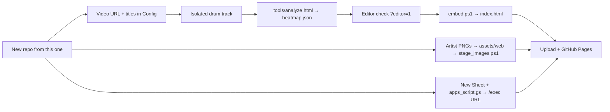
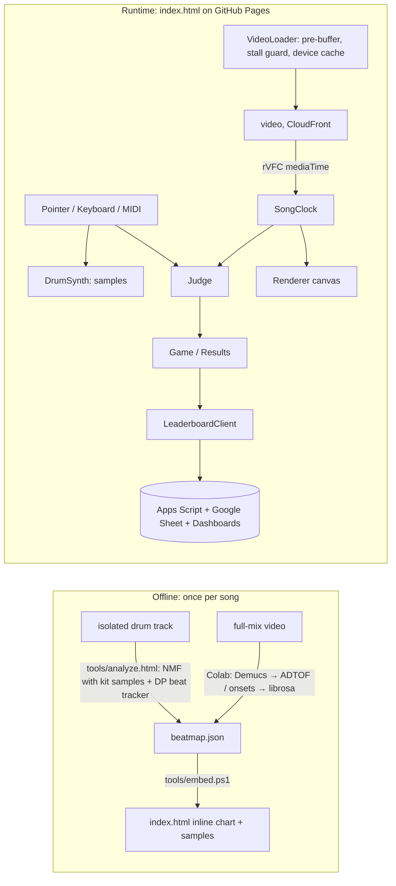
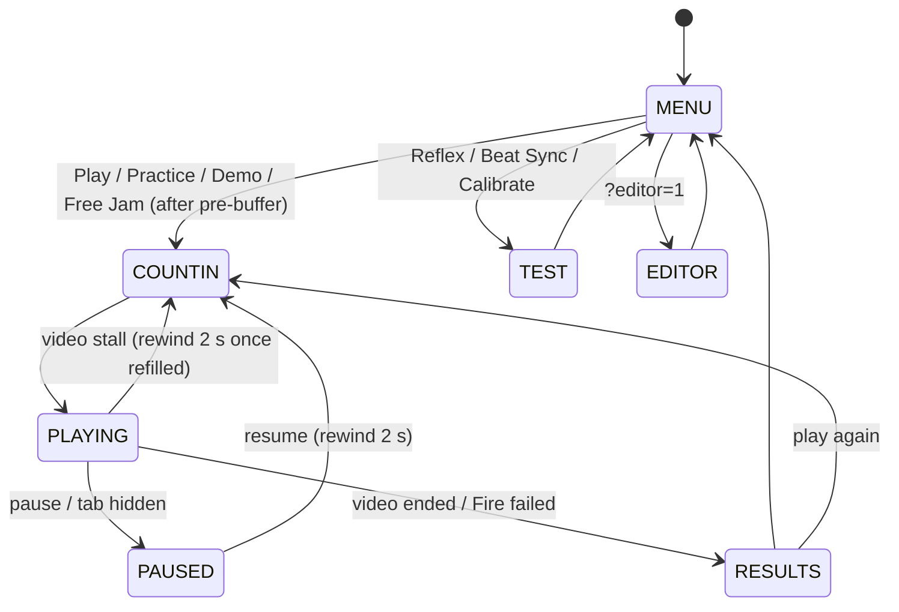
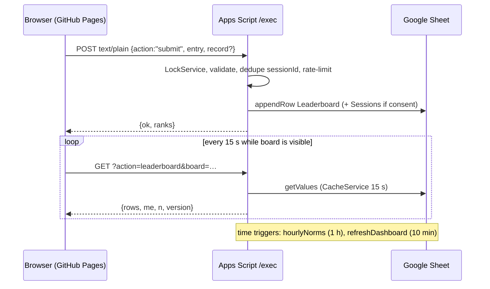

# intelliCARE Music Play-a-Long — Technical and Scientific Manual

**Version** 1.2.0 · **Date** 22 November 2026 · **Institution** Republic Polytechnic, School of Sports & Health · **Author** _[author name]_ · **Licence** _[to be decided]_

Launch song: **心跳的花蕾 | Buds of a Heartbeat**, performed by **Grace Liew 刘嘉意**.

> For fun and engagement only. This application is **not a medical or clinical assessment**.

---

## Quick links

| Resource | URL | Who uses it |
|---|---|---|
| **Play the game (web app)** | <https://aaron-chen-angus.github.io/intellicare-playalong-grace01/> | Players, facilitators |
| **Live Dashboard (Google Sheet)** | <https://docs.google.com/spreadsheets/d/1M92hn8TyPRbegZE4g470PJlsSx_5sDqmg95kbtDW6uk/edit?usp=sharing> | Project team. Open the **Dashboard** tab |
| **Live web dashboard (filterable)** | <https://script.google.com/macros/s/AKfycbw5UvYkTF_nZgu21LzXBwVwUZMFZj2vNK8DsSK7FWqTd4zIB7vIpnTmAtHWEpY93oeBDQ/exec?action=dashboard> | Project team, presentations, phones |
| **Backend API (Apps Script Web App)** | <https://script.google.com/macros/s/AKfycbw5UvYkTF_nZgu21LzXBwVwUZMFZj2vNK8DsSK7FWqTd4zIB7vIpnTmAtHWEpY93oeBDQ/exec> | The game (`Config.SHEETS_ENDPOINT`) |
| **Source code (GitHub)** | <https://github.com/aaron-chen-angus/intellicare-playalong-grace01> | Developers, Kiro |

**Useful URL options for the game**

| Add to the game URL | Effect |
|---|---|
| `?editor=1` | Shows the **Chart Editor** button on the start screen |
| `?debug=1` | Shows the timing and fps overlay and checks that nothing overlaps the video |
| `?test=1` | Runs the built-in test harness (23 tests) |
| `?chart=beatmap.json` | Loads a chart file from the repo instead of the embedded chart |
| `?video=<url>` | Plays a different copy of the video, for example a lighter web copy |

---

## Contents

**Part A — Operations**
- A1. What the app does (summary)
- A2. Repository layout
- A3. Configuration reference (`Config` in `index.html`)
- A4. Google Sheets backend and dashboards
- A5. Updating the live site
- **A6. Creating a new song edition (step-by-step replication guide)**
- A7. Kiro hand-over prompt

**Part B — Technical and Scientific Manual**
1. Introduction · 2. Scientific background · 3. System overview · 4. Chart (beatmap) production · 5. Real-time engine · 6. Judging, scoring and gamification · 7. Performance metrics · 8. Reflex and Beat Sync tests · 9. Normative comparison · 10. Validity, reliability and limitations · 11. Data protection and ethics · 12. Architecture and code organisation · 13. Deployment · 14. User and facilitator guide · 15. Testing and quality assurance · 16. Maintenance and roadmap · References · Appendices A–F

**List of figures.** Fig. 1 Offline/runtime architecture · Fig. 2 Game state machine · Fig. 3 Leaderboard data flow · Fig. 4 New-song workflow

**List of equations.** (1) Song clock · (2) Jitter smoothing · (3) Highway projection · (4) Score per hit · (5) Maximum score · (6) Weighted accuracy · (7) Mean asynchrony · (8) Timing SD · (9) Phase · (10) Consistency R · (11) Rayleigh p · (12) Chord simultaneity · (13) Limb independence · (14) RT summary · (15) Rhythm Index · (16) Coordination Index · (17) z-score · (18) Cohort percentile rank · (19) Level from XP

---

# Part A — Operations

## A1. What the app does

A single-page, framework-free web game in the style of Guitar Hero and Rock Band. The performance video plays at the top. Players finger-drum along on five on-screen pads: SNARE, HI-HAT, TOM and CYMBAL in the top row, and a full-width KICK bar below. Glossy 3D gems fall down a perspective note highway to show which pad to hit and when.

- **Drum sounds:** each hit plays the project's own recorded samples (`sounds/KICK.mp3` and the others), embedded in the page.
- **Visual feedback:** hits trigger strikers, flames, particles and a spectrum strip, all drawn below or beside the video and never over it.
- **Chart:** the drum part comes from the isolated drum track of the song (Section 4).
- **Scores:** saved locally and sent to a shared Google Sheet, which drives the live leaderboard, cohort norms and the dashboards.
- **Start screen:** the performer appears under interactive spotlights, with a heartbeat pink glow, shockwave rings and particle bursts. Tapping her cycles through her stage poses.

**Modes:** Play, Practice (0.5×/0.75×/1×, section loop, A–B loop), Free Jam, Demo (auto-play), Calibration, Reflex Test (simple and 4-choice reaction time), Beat Sync Test (paced tapping) and Chart Editor.

**Difficulties:**
- **Gentle:** kick + snare only, forgiving timing windows. Designed for seniors.
- **Groove:** 4 pads (toms folded into snare).
- **Fire:** all 5 pads.

**Controls:**
- **Touch:** multi-touch pads.
- **Keyboard:** **1 2 3 4** and **Space** by default (SNARE, HI-HAT, TOM, CYMBAL, KICK). Keys can be re-bound in Settings → Keyboard keys.
- **Other keys:** **Esc/P** pauses, **Enter** activates Heartbeat Mode.
- **MIDI:** optional Web MIDI drum input.

## A2. Repository layout

```
/ (GitHub Pages root)
├── index.html                  # the entire app: CSS + JS + embedded chart (beatmap) + embedded drum samples
├── README.md                   # this manual
├── assets/
│   ├── web/                    # master artist images (transparent PNG cut-outs, 1024×1536)
│   │   ├── grace-hero.png          # default start-screen pose (+ header avatar)
│   │   ├── grace-guitar-01.png
│   │   ├── grace-guitar-02.png
│   │   ├── grace-guitar-03.png
│   │   └── grace-portrait.png
│   └── stage/                  # phone-optimised copies (640×960) actually loaded by the app
├── sounds/                     # KICK.mp3 SNARE.mp3 HI-HAT.mp3 TOM.mp3 CYMBAL.mp3 (+ isolated drum track of the song)
└── tools/
    ├── apps_script.gs          # Google Apps Script backend: API, validation, norms, Dashboard tab, web dashboard
    ├── sheets_template.md      # Sheet tabs and columns reference
    ├── analyze.html            # in-browser drum-stem analyser → beatmap.json (NMF with the drum samples)
    ├── beatmap_pipeline.ipynb  # Google Colab pipeline (Demucs → ADTOF → librosa) + web-video encoder (cell 8)
    ├── run_analyze.ps1         # runs analyze.html headless in Edge on sounds/*drums.wav → tools/_check/beatmap.json
    ├── cdp_run.ps1             # helper: drives headless Edge through the DevTools protocol
    ├── embed.ps1               # cleans the chart and embeds chart + samples into index.html
    ├── prep_assets.ps1         # base64-encodes the 5 drum samples → tools/_check/samples.json (see warning in A6)
    ├── stage_images.ps1        # assets/web/*.png → assets/stage/*.png (640 px wide)
    ├── hero_image.ps1          # one-off: rebuild assets/web/grace-hero.png from a photo in assets/
    ├── shots.ps1               # headless screenshots + test run → tools/_check/
    └── README.md               # chart-generation guide
```

Files named `tools/_*` and `tools/_check/` are working output from the scripts and can be ignored. The large source photos and the drum `.wav` at the repository root are not loaded by the app.

## A3. Configuration reference (`Config` in `index.html`)

Search `index.html` for `const Config = {`. These are the only values that change per song or deployment.

| Key | Current value | Purpose |
|---|---|---|
| `APP_VERSION` | `'1.0.0'` | Sent with each submission (raise it when you release) |
| `SHEETS_ENDPOINT` | `https://script.google.com/macros/s/AKfycbw5…QDQ/exec` | Apps Script Web App URL. Leave `''` to run local-only |
| `VIDEO_WEB` | `''` | Optional URL of a lighter web copy of the video (recommended, see 13.3) |
| `HERO_IMG` | `'assets/stage/grace-hero.png'` | Default start-screen image, also used for the header avatar |
| `HERO_IMGS` | 5 images in `assets/stage/` | Poses cycled when the artist is tapped (the first is the default) |
| `AVATAR_IMG` | _(not set)_ | Optional separate header-avatar image. Falls back to `HERO_IMG` |
| `SONG_ID` | `'buds-of-a-heartbeat'` | Key used for leaderboards, bests and editor drafts. **Must be unique per song** |
| `song.zh`, `song.en`, `song.artist` | 心跳的花蕾 · Buds of a Heartbeat · Grace Liew 刘嘉意 | Shown on the start screen, header, results, share card and page title |
| `song.ghost` | `'心跳'` | 1–3 characters drawn huge and faint behind the artist |
| `song.video` | CloudFront MP4 URL | The performance video |
| `COLORS`, `PINK` | lane colours, `#FF6FB5` | Lane colours and the Heartbeat theme colour (the CSS variable `--pink` matches) |
| `WIN`, `PTS` | see Section 6 | Judging windows and points. Changing them also changes the manual |

Other per-song content lives in two embedded blocks: `<script type="application/json" id="beatmap">` (the chart, Appendix A) and `<script type="application/json" id="drumSamples">` (base64 MP3s). Both are written by `tools/embed.ps1`.

Player preferences (keys, volumes, offset, language and so on) are stored per device in `localStorage` (Appendix B), not in `Config`.

## A4. Google Sheets backend and dashboards

**Sheet:** <https://docs.google.com/spreadsheets/d/1M92hn8TyPRbegZE4g470PJlsSx_5sDqmg95kbtDW6uk/edit?usp=sharing>
**Script:** `tools/apps_script.gs`, server version 1.1.0, bound to the Sheet by `SHEET_ID`.

| Tab | Content |
|---|---|
| **Dashboard** | Live visual summary (below) |
| **Leaderboard** | One row per accepted submission. Tick `hidden` to remove a row from all public boards |
| **Sessions** | Full session records, only for players who gave remote consent (private) |
| **Players** | Rate-limit bookkeeping |
| **Charts** | Score ceilings per difficulty: Gentle 331 notes / 379,200 · Groove 1,472 / 1,748,400 · Fire 1,793 / 2,133,600 |
| **NormsAgg** | Hourly cohort deciles per metric × age band × gender (cells with n ≥ 30) |
| **Config** | `currentSeason` (change it to start a new season), `seasonStart`, `profanityList` |
| **Log** | Rejected submissions with the reason |
| **DashData** | Chart source tables written by the script. Do not edit |

### Dashboard tab (inside the Sheet)

Dark-themed and refreshed automatically **every 10 minutes**. To refresh immediately, use the Sheet menu **🎵 intelliCARE → Refresh dashboard now**.

- **8 KPI tiles:** song runs, players, runs today, average accuracy, best score, median simple RT, median 4-choice RT and average Rhythm Index.
- **8 charts:** runs per day (30 days), difficulty mix, accuracy by age band × gender, reaction time by age band, Rhythm and Coordination Index by age band, accuracy distribution, hit rate per pad, and timing (asynchrony and SD) by age band.
- **Tables:** top 10 players, a weekday × 3-hour activity heat-map, and the expected-pad → hit-pad confusion matrix (green diagonal = correct).

### Live web dashboard (R-Shiny style)

<https://script.google.com/macros/s/AKfycbw5UvYkTF_nZgu21LzXBwVwUZMFZj2vNK8DsSK7FWqTd4zIB7vIpnTmAtHWEpY93oeBDQ/exec?action=dashboard>

It shows the same content as the Dashboard tab, plus filters for **period** (all / 30 days / 7 days / today), **difficulty**, **age band** and **gender**. It auto-refreshes every 60 s, works on phones and suits a projector during sessions. The menu item **🎵 intelliCARE → Open live web dashboard** shows the link.

**Privacy:** both dashboards show aggregates only, plus public nicknames in the top-10 table. Hidden rows are excluded. Pad accuracy, confusion and timing charts use consented Sessions records only.

### Maintaining the script

- After editing the script: **Deploy → Manage deployments → ✎ → Version: New version → Deploy**. The `/exec` URL stays the same.
- `setup()` is safe to re-run. It never deletes data and it re-creates the triggers (`hourlyNorms` every hour, `refreshDashboard` every 10 minutes).
- Health check: opening the `/exec` URL should return `{"ok":true,"version":…,"season":"S1","server":"1.1.0"}`. This was confirmed on 21 November 2026.

## A5. Updating the live site

GitHub Pages serves the `main` branch root of <https://github.com/aaron-chen-angus/intellicare-playalong-grace01>.

1. Change files locally.
2. Upload them on GitHub (**Add file → Upload files**, or commit with git) and keep the same folder paths.
3. Wait 1–2 minutes, then hard-refresh the site (Ctrl+F5, or reopen the tab on a phone).

The files that matter at runtime are `index.html`, `assets/stage/*`, and `sounds/*.mp3` (a fallback only, since the samples are embedded).

## A6. Creating a new song edition (step-by-step replication guide)

The goal is a new repository, for example `intellicare-playalong-<artist><nn>`, that is a copy of this one with a different song, chart, sounds and pictures. All game logic stays the same.


*Figure 4. New-song workflow.*

### Step 0 — Gather the inputs

| Input | Requirement |
|---|---|
| Performance video | MP4 (H.264/AAC) at a public HTTPS URL, such as CloudFront/S3. Ideally also a 720p web copy (see Step 8) |
| Isolated drum track | WAV or MP3 of the drums only, **starting at exactly the same moment as the video** (same 0:00). If it is not available, use the Colab notebook to separate it (Demucs) |
| Drum samples | Five short one-shots named exactly `KICK.mp3`, `SNARE.mp3`, `HI-HAT.mp3`, `TOM.mp3`, `CYMBAL.mp3`, each under about 50 KB. Ideally use the kit from the recording |
| Artist images | 3–6 transparent-background PNG cut-outs, full body, portrait orientation (about 2:3), around 1024×1536 |
| Text | Chinese title, English title, performer credit, and 1–3 characters for the faint background `ghost` text |

### Step 1 — Create the repository

1. On GitHub, open this repository → **Use this template** (or download the ZIP) → create `intellicare-playalong-<artist><nn>`.
2. **Settings → Pages →** Source: *Deploy from a branch*, Branch: `main` / `(root)` → Save.

### Step 2 — Song details in `Config`

In `index.html`, inside `const Config = {`:
- Set `SONG_ID` to a new kebab-case id, for example `'moonlight-river'`. This keeps scores and bests separate from other songs.
- Set `song.zh`, `song.en`, `song.artist`, `song.ghost` and `song.video`.
- Clear `VIDEO_WEB` (`''`) until you have a web copy.

Every visible title, header, page title and share card reads from `Config.song`, so nothing else needs editing for text. The `<title>` and the header strip in the HTML are placeholders that are overwritten at start-up.

### Step 3 — Drum samples

Replace the five files in `sounds/` with the new ones, keeping the same names. Then run:
```
powershell -ExecutionPolicy Bypass -File tools\prep_assets.ps1
```
This writes `tools/_check/samples.json`.

> ⚠ `prep_assets.ps1` also rebuilds `assets/web/grace-hero.png` from `assets/Grace Liew with Guitar 09*`. For a new artist, delete that part of the script, or check that it finds no file, before running it. Otherwise it may overwrite a hero image.

### Step 4 — Chart (beatmap)

Option A, recommended (uses the isolated drum track):
1. Put the drum track in `sounds/` with a name ending in `drums.wav`.
2. Run `powershell -ExecutionPolicy Bypass -File tools\run_analyze.ps1`. It writes `tools/_check/beatmap.json`, check images (`check0–3.png`) and the log.
3. Alternatively, open `tools/analyze.html` in Edge or Chrome, choose the drum track and all five samples, press **Analyse**, then **Download beatmap.json**, and save it as `tools/_check/beatmap.json`.
4. In the downloaded file, the `song` block still holds the launch song's titles and video URL. Edit them to the new song (they are informational only, since `Config.song` is what the app displays).

Option B (no drum track): run `tools/beatmap_pipeline.ipynb` in Google Colab (GPU). It separates the drums with Demucs, transcribes them with ADTOF or a fallback, and downloads `beatmap.json`.

### Step 5 — Embed chart and samples

```
powershell -ExecutionPolicy Bypass -File tools\embed.ps1
```
This removes tom notes within 45 ms of a kick, and cymbal notes within 50 ms of a hi-hat or snare unless they fall on a downbeat. It then writes the chart into `<script id="beatmap">` and the samples into `<script id="drumSamples">`. The console prints note counts before and after the clean-up.

### Step 6 — Check and correct the chart

1. Open `index.html` in a browser (or the live site) with `?editor=1` → **Chart Editor**.
2. Play the video and check that gems arrive on the audible drums.
   - Use **Off −1 / Off +1** to shift the whole chart.
   - Fix individual notes: tap to add, tap and drag to move, **Del** to delete.
   - Rename sections with **＋Section**.
3. Press **Generate** and note the number of notes and the `maxScore` for each difficulty.
4. Press **Copy inline** and replace the `<script type="application/json" id="beatmap">…</script>` block in `index.html` with the copied block (or **Export** a `beatmap.json`).
5. Run `?test=1`. All tests must pass.

### Step 7 — Artist images and stage effects

1. Put the PNG cut-outs in `assets/web/` (any names, lowercase-with-hyphens recommended).
2. Run `powershell -ExecutionPolicy Bypass -File tools\stage_images.ps1`. This creates the 640 px copies in `assets/stage/`.
3. In `Config`, set `HERO_IMG` (default pose) and `HERO_IMGS` (the poses to cycle, first = default). These are paths under `assets/stage/`. Optionally set `AVATAR_IMG`.
4. If the header avatar crops badly, adjust the background position in the CSS rule `#hdr .gAv` (`… 44% 5%/300% …`).
5. Optional theme colour: change `Config.PINK` and the CSS variable `--pink` (both `#FF6FB5`), plus the pink values in the `#premium` style block.
6. Optional song-specific flavour: the Heartbeat Mode name, the "bud" notes and some achievement names (Heartbeat Hero, Heartbeat Legend) follow the launch song. They can be renamed in `ACH`, `RANKS` and the UI strings.

### Step 8 — Video performance

- Master videos are often 300–600 MB. Run **cell 8** of `tools/beatmap_pipeline.ipynb` to make a 720p, about 3.5 Mbit/s "faststart" copy (about 100 MB for 4 minutes), upload it next to the master, and set `Config.VIDEO_WEB`.
- Optional: add a CORS rule on the S3 bucket (GET/HEAD from `https://<user>.github.io`). Players can then use Settings → **Save video to this device** for buffering-free play.

### Step 9 — Google Sheet backend

Use **one Google Sheet per song**. The dashboards aggregate everything in their Sheet.
1. Create a new Google Sheet. Open **Extensions → Apps Script**, paste `tools/apps_script.gs`, then edit the constants at the top:
   - `SHEET_ID`: the id in the new Sheet's URL.
   - `GAME_URL`: the new GitHub Pages URL.
   - `SONG_ID`: the same value as in `Config`.
   - `CHART_DEFAULTS`: `[difficulty, noteCount, maxScore]` for Gentle, Groove and Fire, from the Editor's **Generate**. For N ≥ 30 notes, maxScore = 1200 × N − 18,000.
2. Run `setup` and authorise.
3. **Deploy → New deployment → Web app**: *Execute as: Me*, *Who has access: Anyone*. Copy the `/exec` URL.
4. Paste the URL into `Config.SHEETS_ENDPOINT` in `index.html`.
5. Test: `<exec>?action=ping` should return `"ok":true`. Then play one song with a named profile. A row should appear in **Leaderboard**, and the Dashboard should update within 10 minutes (or use Refresh now).

### Step 10 — Publish and verify

1. Upload `index.html`, `assets/stage/`, `assets/web/`, `sounds/` and `tools/`.
2. On the live URL, check the following:
   - The start screen shows the new titles and artist, and tapping the artist bursts and cycles poses.
   - Play → the gems line up with the drums.
   - The pads play the new samples.
   - The results screen shows "#1 of 1 worldwide".
   - `?test=1` passes.
3. Update this README's Quick links and the version history (Appendix F).

### Replication checklist

- [ ] New repository + GitHub Pages enabled
- [ ] `Config`: `SONG_ID`, `song.*`, `VIDEO_WEB`, `HERO_IMG(S)`, `SHEETS_ENDPOINT`
- [ ] `sounds/` samples replaced → `prep_assets.ps1`
- [ ] Chart analysed → `embed.ps1` → checked in Editor → `?test=1` passes
- [ ] `assets/web` → `stage_images.ps1` → `assets/stage`
- [ ] New Sheet + script constants + `setup` + deployment
- [ ] Web video copy (optional but recommended)
- [ ] README Quick links + changelog updated

## A7. Kiro hand-over prompt

To create the next edition with Kiro, open the new (copied) repository in Kiro and paste:

> This repository is a copy of https://github.com/aaron-chen-angus/intellicare-playalong-grace01. Follow README section **A6 "Creating a new song edition"** exactly, and do not change game logic.
> New song: Chinese title «…», English title «…», performer «…», ghost text «…», song id «…».
> Video URL: «…» (web copy: «…» or none).
> Drum track: `sounds/<name>drums.wav`. Drum samples: `sounds/KICK.mp3` … `CYMBAL.mp3`.
> Artist images: `assets/web/…` (default pose: «…»).
> Google Sheet ID: «…» (I will give you the /exec URL after deploying).
> When done, report the note counts per lane, the maxScore per difficulty, the `?test=1` result and screenshots of the start and play screens.

---

# Part B — Technical and Scientific Manual

## Abstract

intelliCARE Music Play-a-Long is a browser-based, gamified finger-drumming activity. Its target users are community seniors, students and the general public. A participant watches a music-performance video and plays along on five on-screen pads (kick, snare, hi-hat, tom and cymbal), guided by falling note "gems" on a perspective highway.

The drum chart is derived from an isolated drum recording. Supervised non-negative matrix factorisation (NMF) uses the kit's own one-shot samples as spectral templates, onsets are peak-picked from each drum's activation (Bello et al., 2005; Wu et al., 2018), and a dynamic-programming beat tracker estimates the beat grid (Ellis, 2007). An alternative Colab pipeline separates drums from a full mix with Hybrid Transformer Demucs (Rouard et al., 2023) and transcribes them with ADTOF (Zehren et al., 2021, 2023).

At runtime the application interpolates a song clock from the video's presentation timestamps, judges each tap against timing windows, plays recorded drum samples through the Web Audio API (W3C, 2021), and records timing metrics derived from the sensorimotor-synchronisation literature (Repp, 2005; Repp & Su, 2013). Two short assessments are included. A Reflex Test measures simple and four-choice reaction time, following the general protocol of Der and Deary (2006). A Beat Sync Test adapts paced tapping from BAASTA (Dalla Bella et al., 2017, 2024). Results can be compared with cohort percentiles and, once verified values are entered, with literature reference values.

A Google Apps Script back end supplies a shared live leaderboard, aggregated cohort norms and live dashboards. Every composite index in the application is a heuristic engagement measure, not a validated psychometric scale. The application is not a medical or clinical assessment.

### Glossary

| Term | Meaning |
|---|---|
| Pad / lane | One of five drum zones (KICK, SNARE, HI-HAT, TOM, CYMBAL) and its column on the highway |
| Gem / note | An expected hit `{t, l}` (time in seconds, lane) |
| Beatmap / chart | JSON file of notes, beats, downbeats and sections (Appendix A) |
| Asynchrony | Signed tap time minus target time, in ms (negative = early) |
| IBI / IOI | Inter-beat interval / inter-onset interval |
| NMF | Non-negative matrix factorisation: spectrogram ≈ templates × activations |
| Heartbeat Mode | The app's "Star Power": ×2 score for 8 bars |
| Bud note | A note in a Heartbeat phrase (pink outline) |
| Stray | A press with no note in range on any lane |
| Wrong-pad hit | A press on lane A while a note on lane B was within the GOOD window |
| Edition | One song build of the app (one repository, one Sheet) |

## 1. Introduction

**Purpose.** The application provides an enjoyable rhythm activity for intelliCARE community sessions. As a by-product of play, it collects simple timing measures that participants and facilitators can use to follow engagement and progress.

**Target users.** Community-dwelling seniors (the Gentle difficulty has wider windows and kick + snare only), students, and the general public on phones (portrait first), tablets and desktops.

**Scope.** One song per edition (repository). The chart is produced offline and embedded. Local profiles live on the device, with a shared Google Sheet for leaderboards, norms and dashboards.

**Intended use and disclaimer.** The application is for recreation and engagement. Reaction-time and rhythm outputs are indicative only. They are affected by device latency (Section 10) and **must not be used for diagnosis, screening or clinical decisions**. Every results screen states: "For fun and engagement — not a medical or clinical assessment."

## 2. Scientific background

### 2.1 Sensorimotor synchronisation and finger tapping
Tapping in time with an isochronous pacing signal is the canonical paradigm of sensorimotor synchronisation (SMS). Adults typically tap slightly ahead of the beat (*negative mean asynchrony*), and they correct their timing continuously through phase and period error correction (Repp, 2005; Repp & Su, 2013). Variability of asynchronies indexes timing precision. Circular statistics, which treat each tap as a phase angle relative to the beat cycle, give a consistency measure that is robust to occasional large errors (Fisher, 1993). BAASTA operationalises these measures in a test battery (Dalla Bella et al., 2017), and its mobile version reports adult norms (Dalla Bella et al., 2024).

### 2.2 Reaction time
Simple reaction time (SRT, one stimulus and one response) and choice reaction time (CRT, several stimulus–response pairs) slow with age. CRT shows larger age effects, and sex differences appear in both mean RT and intra-individual variability (Deary & Der, 2005; Der & Deary, 2006; Dykiert et al., 2012). SRT latency also depends on hardware and procedure (Woods et al., 2015). Web and touchscreen platforms add tens of milliseconds of device-dependent delay (Anwyl-Irvine et al., 2021; Pronk et al., 2020).

### 2.3 Rhythm and ageing; music-based activity for older adults
Beat synchronisation changes across the lifespan, and musical experience moderates it (Thompson et al., 2015). Older adults show changes in timing error correction, especially at slower tempi (Pollok et al., 2023). Rhythm-based activity is a core element of neurologic music therapy techniques (Thaut & Hoemberg, 2014). The present application is not a therapeutic intervention, but it uses the same engaging rhythmic structure.

### 2.4 Gamification and motivation
Gamification is the use of game-design elements in non-game contexts (Deterding et al., 2011). Reviews report mostly positive but context-dependent effects (Hamari et al., 2014). The design draws on self-determination theory (Ryan & Deci, 2000). Competence is supported by graded difficulty, immediate feedback and coaching tips. Autonomy comes from free choice of mode, difficulty and key bindings. Relatedness comes from shared leaderboards, facilitator sessions and the performer's on-stage presence. Flow (Csikszentmihalyi, 1990) is supported by matching challenge to skill through three difficulties, practice speed and section loops.

## 3. System overview

**Modes:** Play (scored), Practice (0.5×/0.75×/1× speed, section loop, A–B loop, no fail, not recorded), Free Jam (no notes), Demo (auto-play), Calibration, Reflex Test, Beat Sync Test, Chart Editor (`?editor=1`).


*Figure 1. Offline and runtime architecture.*


*Figure 2. Game state machine (`Game.state`).*

## 4. Chart (beatmap) production

### 4.1 Launch-song chart: provenance and figures
The shipped chart was produced by `tools/analyze.html` from the isolated drum recording `心跳的花蕾drums.wav` (228.76 s, 44.1 kHz). It was then cleaned by `tools/embed.ps1` (Section 4.4).

| Quantity | Value |
|---|---|
| Tempo / beats / bars | 93.96 BPM · 359 beats · 90 bars (4/4 assumed) |
| Notes (full chart) | **1,794**: kick 454 · snare 343 · hi-hat 750 · cymbal 199 · tom 48 |
| Derived difficulties | Fire 1,793 · Groove 1,472 · Gentle 331 notes |
| Alignment | The drum track is assumed to start at video 0:00 (offset 0 ms); correct with the Editor offset if needed |
| Sections | Detected automatically (Intro 0.69 s, Chorus 1 13.44 s, Chorus 2 33.86 s, Verse 1 194.69 s, Outro 207.44 s). Names are heuristic and should be reviewed |

### 4.2 Supervised NMF transcription (`tools/analyze.html`)
1. **Spectrogram.** 2,048-point Hann STFT, hop 10 ms. Magnitudes are pooled into 96 log-spaced triangular bands from 30 Hz to 16 kHz, giving $V \in \mathbb{R}_{\ge 0}^{96 \times T}$.
2. **Templates.** Each of the five kit samples is analysed the same way. Its spectrum is summed from the energy peak over 80 ms (kick, tom: 150 ms; cymbal: 400 ms) and normalised to unit sum, giving $W_0 \in \mathbb{R}^{96 \times 5}$.
3. **Factorisation.** $V \approx WH$ by multiplicative updates of the generalised Kullback–Leibler divergence, run for 60 iterations. $W$ is fixed for the first 60 % of iterations. After that it is updated and pulled 50 % back towards $W_0$ each iteration (semi-adaptive), which absorbs room and mix differences without letting a template drift into another drum (Wu et al., 2018).
4. **Onsets.** For each drum's activation $h_k$, the onset function $d_k[n] = \max(0, h_k[n] - \max(h_k[n-1], \tfrac12(h_k[n-1]+h_k[n-2])))$ is peak-picked with a ±3-frame local-maximum test. Peaks must clear an absolute floor (a fraction of the 99.5th percentile of $h_k$) and a relative floor against the 1 s moving maximum, with a minimum gap of 60 ms (hi-hat) or 80 ms (others) (Bello et al., 2005).
5. **Crosstalk suppression.** A weak onset is discarded when a neighbouring lane (kick↔tom, snare↔tom/hi-hat, hi-hat↔cymbal) has a much stronger onset within ±20 ms. The ratio threshold is 0.35 after per-lane normalisation.
6. **Timing refinement.** Each onset is moved to the steepest rise of a 1 ms peak envelope within −35/+15 ms: low-passed at 150 Hz for kick and tom, broadband otherwise. Same-lane duplicates within 40 ms are merged. Velocity is $v = \min(1, 0.45 + 0.55\, d/d_{98})$.

### 4.3 Beat, downbeat and section estimation
- The weighted sum of positive activation increases (kick 1.2, snare 1, hi-hat 0.4, tom and cymbal 0.6) forms the onset envelope.
- Tempo comes from its autocorrelation with a log-Gaussian prior centred on 120 BPM. Beats come from the dynamic-programming tracker of Ellis (2007) with α = 400. Each beat is then snapped to the nearest kick or snare within 40 ms.
- The downbeat phase is the one that best fits kick on 1 (and 3), snare on 2 and 4, and cymbal on 1.
- Sections come from a 4-bar novelty curve over per-bar drum-count features. Dense segments are labelled Chorus and sparser ones Verse, Intro or Outro.

### 4.4 Post-processing (`tools/embed.ps1`)
- A tom within 45 ms of a kick is removed, since kick energy leaks into the tom template (451 → 48 toms in the launch chart).
- A cymbal within 50 ms of a hi-hat or snare is removed unless it lies within 60 ms of a downbeat. This targets accented hats and snare wash (336 → 199 cymbals).

### 4.5 Alternative Colab pipeline (`tools/beatmap_pipeline.ipynb`)
For songs without a drum track:
- The full mix is separated with Hybrid Transformer Demucs (`htdemucs`, `--two-stems=drums`; Rouard et al., 2023).
- ADTOF transcribes the stem into MIDI (Zehren et al., 2021, 2023). If ADTOF fails, a band-split spectral-flux onset detector is used instead.
- librosa estimates beats and sections (Ellis, 2007; McFee et al., 2015).
- General MIDI pitches map to lanes as shown below (identical in the notebook and in `Config.GM`).
- **Cell 8** encodes the 720p web copy of the video.

| Lane | GM pitches |
|---|---|
| kick | 35, 36 |
| snare | 37, 38, 39, 40 |
| tom | 41, 43, 45, 47, 48, 50 |
| hihat | 42, 44, 46 |
| cymbal | 49, 51, 52, 53, 55, 57, 59 |

### 4.6 Difficulty derivation (runtime, `Beatmap.derive*`)
Used when the beatmap contains no pre-baked difficulties:

| Difficulty | Rule |
|---|---|
| **Fire** | Full chart; minimum gap per lane 60 ms |
| **Groove** | tom → snare; a hi-hat note is kept only if within 40 ms of an 8th-note grid point; hi-hat within 40 ms of a cymbal is dropped; minimum gap per lane 110 ms |
| **Gentle** | kick, snare and tom (tom → snare) only; a note must be within 0.35 IBI of a beat; at most one note per beat, preferring kick on beats 1 and 3 and snare on beats 2 and 4, then the note closest to the beat; minimum gap 300 ms |

- **Bud flags** (Heartbeat phrases): if the chart has none, every note in bars 8, 16, 24, … is flagged.
- **4-pad mode** maps tom → snare at runtime and re-applies a 60 ms gap.
- Notes on different lanes within 6 ms of each other are marked as **chords**.
- If `charts.full` is empty, a labelled 100 BPM placeholder rock beat is generated.

### 4.7 Expected accuracy and manual correction
Automatic transcription is usually strongest for kick, snare and hi-hat and weaker for toms and cymbals (Wu et al., 2018; Zehren et al., 2023). Every chart should therefore be reviewed in the Chart Editor:
- offset nudge (±1 ms),
- add, move and delete notes; tap-record,
- snap (off, 1/4, 1/8, 1/16, triplet),
- sections, bud flags, and up to 60 undo steps,
- Generate (difficulties + maxScore), Import, Export and Copy inline.

## 5. Real-time engine

### 5.1 Song-clock model
`video.currentTime` updates coarsely, so the song clock interpolates between presentation anchors supplied by `requestVideoFrameCallback` (`metadata.mediaTime`). Where that API is missing, it samples `currentTime` every 50 ms instead.

$$t_\text{song}(t_\text{perf}) = m_a + \frac{t_\text{perf} - p_a}{1000}\,r - \frac{o_\text{user} + o_\text{chart}}{1000} \tag{1}$$

Here $m_a$ is the anchor media time (s), $p_a$ the anchor `performance.now()` (ms), $r$ the playback rate, and $o$ the offsets (ms). When a new frame arrives with media time $m$ and the prediction is $\hat m$:

$$m_a \leftarrow \begin{cases}\hat m + 0.2\,(m-\hat m) & |m-\hat m| < 30\ \text{ms}\\ m & \text{otherwise (seek or stall)}\end{cases} \tag{2}$$

On `play`, `pause`, `seeked`, `ratechange`, `waiting`, `ended` and `canplay`, the anchor snaps to `currentTime`. Input events are judged at `event.timeStamp`, which uses the same time base as `performance.now()`, so the judged time is the touch time rather than the time the handler ran.

### 5.2 Video delivery (`VideoLoader`)
- **Source.** The video is chosen in this order: the `?video=` URL parameter, then `Config.VIDEO_WEB`, then `Config.song.video`. If a copy is saved in Cache Storage (`icmpal-video-v1`), it is played from the device with no network.
- **Pre-buffer.** Before the count-in, the app loads up to 25 s ahead (or until `readyState` 4 with at least 60 % of the target). A progress ring is shown, and "Start anyway" appears after 6 s.
- **Stall guard.** If, during play, `readyState` < 3 and less than 0.3 s is buffered ahead for over 350 ms, video and judging pause together. Play resumes once 8 s are buffered (or `readyState` 4, or after 30 s), with a 2 s rewind and a 3-2-1 count-in, so the chart never drifts from the video.
- **Device cache.** Settings → **Save video to this device** streams the whole file into Cache Storage. This requires CORS on the CDN. The launch master (523.9 MB) currently has no CORS header, so the button explains that and the app streams instead.

### 5.3 Input pipeline and latency budget
- Pads respond to `pointerdown` (multi-touch, pointer capture), never to `click`.
- The handler runs synchronously: sample voice → judge → FX queue. It never waits for the render loop.
- The AudioContext uses `latencyHint: "interactive"`.
- **Keyboard:** defaults 1 = snare, 2 = hi-hat, 3 = tom, 4 = cymbal, Space = kick. Keys are re-bindable in Settings, swapping if a key is already used. Esc, P, Enter and Tab are reserved, and auto-repeat is ignored.
- Optional Web MIDI note-on messages with velocity > 0 map through the GM table in Section 4.5.

| Stage | Typical magnitude | Source |
|---|---|---|
| Touch digitiser + OS event delivery | tens of ms, device-dependent | Pronk et al. (2020) |
| Browser event → handler | < 1–2 ms | — |
| Web Audio output (interactive) | device-dependent, often 10–40 ms | W3C (2021) |
| Bluetooth audio | about 150–300 ms (shown as advice in the app) | — |
| Display (for visual stimuli) | about 1–2 frames | Anwyl-Irvine et al. (2021) |

_The figures above are indicative; device testing is needed (Section 15)._

### 5.4 Calibration
The app schedules 16 clicks at 600 ms IOI (100 BPM) on the Web Audio clock, starting 1.2 s ahead, with a visual pulse. Click times are converted to the `performance.now()` base with `AudioContext.getOutputTimestamp()`. For each tap, the signed difference to the nearest click is taken, differences with |d| > 150 ms are discarded, and at least 8 valid taps are required. The **median** becomes `Settings.offsetMs`. A manual slider (−200 to +200 ms) is also provided.

### 5.5 Drum sounds (`DrumSynth`)
- **Samples.** The five MP3 one-shots are embedded as base64 in `<script id="drumSamples">`, with `sounds/*.mp3` as a fallback. They are decoded once at start-up with an `OfflineAudioContext` and peak-normalised to 0.9 (maximum gain ×3).
- **Humanisation.** Each hit gets ±1.5 % playback rate and ±1.5 dB of gain.
- **Choke.** A new hi-hat chokes the previous one (12 ms release, stop at +80 ms).
- **Signal path.** Voice gain → pad bus (user volume) → DynamicsCompressor (threshold −10 dB, ratio 4) → Analyser (FFT 256) → output.
- **Fallback synthesis.** If a sample cannot be decoded, a synthesised voice is used:

| Voice | Recipe |
|---|---|
| Kick | sine 150 → 45 Hz over 120 ms; gain 1 → 0.001 over 450 ms; 3 ms noise click through a 3 kHz high-pass |
| Snare | triangle 185 Hz (0.6, 120 ms) + noise → HP 1.2 kHz → BP 3.5 kHz (0.9, 200 ms) |
| Hi-hat | 6 square oscillators at 40·{2, 3, 4.16, 5.43, 6.79, 8.21} Hz (gain 0.35 each) → BP 10 kHz → HP 7 kHz, 0.5 → 0 in 60 ms |
| Tom | sine 120 → 80 Hz over 250 ms, 0.9 → 0 in 400 ms + 5 % noise |
| Cymbal | metallic bank + noise → HP 5 kHz; 2 ms attack, 0.6 → 0.001 over 1.6 s |

The video element is **never** connected to Web Audio, because `createMediaElementSource` on a cross-origin video without CORS outputs silence. The spectrum strip uses the pad-audio analyser instead.

### 5.6 Rendering
**Highway.** The highway is a Canvas 2D element with DPR capped at 2. A pre-rendered fretboard (dark board, lane tints, dividers, chrome rails, far-end fade) is drawn once per resize. For a note with progress $p = 1 - (t_n - t)/A$, where $A$ is the approach time (default 1.8 s, adjustable 1.0–3.0 s, multiplied by playback rate):

$$y = y_\text{hit}\,p^{1.6},\qquad f = f_0 + (1-f_0)\,\frac{y}{y_\text{hit}},\quad f_0 = 0.3 \tag{3}$$

- Lane x positions converge toward the centre by factor $f$, and gems scale by $f$. Flat mode sets $f = 1$.
- Lane centres are measured from the pad elements on every resize, so gems land exactly above their pads. The hit line sits 30 px above the bottom of the highway.
- Gems are pre-rendered 3D discs (glow, cylinder wall, silver rim, coloured top, specular cap). Kick notes are full-width glossy orange bars.
- Strikers are metal rings with lit and unlit sprites. Hits add a flame plume, lane flash, ripple and particles (pool of 400).
- Adaptive quality: after 30 consecutive frames over 20 ms, particle counts are halved and the spectrum is disabled; both recover after 120 good frames.

**Start screen (`MenuFX`).**
- Three sweeping stage beams that follow the pointer and recentre after 4 s idle, plus a soft follow-spot, three lens flares, haze, rising light motes and a perspective stage floor.
- A heartbeat cycle every 1.5 s pulses the artist's pink aura and drop-shadow glow and emits a shockwave ring and a small spark burst.
- Tapping the artist releases about 70 heart, star and spark particles (pool of 360, additive blending) and crossfades to the next pose in `HERO_IMGS`. The PLAY button bursts on hover and press.

**Accessibility and layout.**
- `prefers-reduced-motion` disables shake, spectrum, blossoms, bursts, flares and the follow-spot.
- In portrait, the grid rows are header 32 px → video 16:9 (max 40 dvh) → HUD 36 px → highway (min 22 vh) → pads (height min(24 dvh, 190 px), minimum 136 px).
- In landscape, the video takes about 62 % on the left with song information below, and the game column (≥ 340 px) sits on the right. When landscape height is under 480 px, the header is hidden.
- No game element is drawn over the video; `?debug=1` asserts this every frame.

## 6. Judging, scoring and gamification

| Judgement | Groove / Fire | Gentle | Points |
|---|---|---|---|
| PERFECT | ±45 ms | ±70 ms | 300 |
| GREAT | ±90 ms | ±130 ms | 200 |
| GOOD | ±135 ms | ±200 ms | 100 |
| MISS | note passes +GOOD unhit | same | 0, breaks combo |

- **Wrong pad.** If no note in the struck lane is within GOOD, the nearest unjudged note on another lane within GOOD becomes WRONG in Groove and Fire. That note is consumed, the combo breaks, and the confusion matrix records expected → played. In Gentle, the press is treated as harmless and the note can still be hit.
- **Stray.** The sound plays. In Fire only, a stray costs 20 points (floor 0) and breaks the combo.

$$\text{points} = \text{base} \times m(c) \times (2 \text{ if Heartbeat}),\qquad m(c) = 1 + \min(3, \lfloor c/10 \rfloor) \tag{4}$$

$$S_\text{max} = \sum_{i=0}^{N-1} 300\, m(i) = 1200N - 18\,000 \quad (N \ge 30) \tag{5}$$

$S_\text{max}$ is a full-combo all-PERFECT run with no Heartbeat. For the launch chart it is Gentle 379,200 · Groove 1,748,400 · Fire 2,133,600. The server rejects scores above 2 × $S_\text{max}$. Stars: score ≥ 20/40/60/80/95 % of $S_\text{max}$ gives 1–5★. Grades use weighted accuracy (Eq. 6): S ≥ 95, A ≥ 90, B ≥ 80, C ≥ 70, otherwise D.

- **Rock meter** starts at 0.5. It moves +0.02 for PERFECT, +0.015 for GREAT, +0.008 for GOOD and −0.04 for MISS or WRONG. Only Fire fails, when the meter reaches 0, and offers "Continue in Practice".
- **Heartbeat Mode.** Completing all bud notes of a phrase adds 25 %. At ≥ 50 %, activate with the ♥ button, Enter, or KICK + CYMBAL within 30 ms. Score doubles for 32 beats (8 bars at the local IBI) while the meter drains linearly. The highway turns sakura pink (#FF6FB5) with blossom particles.
- **Achievements (13):** First Beat, 50 Combo, 100 Combo, Full Combo, Perfect Kick (≥ 10 kick notes, all PERFECT/GREAT), Heartbeat Hero (3 activations), Steady Hands (≥ 90 % in Gentle), Fire Starter, Comeback (from < 20 % back to ≥ 50 %), Sharpshooter (0 wrong-pad hits, ≥ 20 hits, Groove/Fire), Metronome (SD < 30 ms, ≥ 30 hits), Section Master (≥ 95 % in every section with ≥ 4 notes, at least 2 sections), Streak 7. Each awards 25 coins.
- **XP.** XP per run = ⌊score/100⌉ plus day-streak bonuses (+100 at 3 days, +300 at 7, +1,000 at 30). Reflex and Beat Sync each give +20 XP. Coins per run = ⌊score/1000⌋.

$$L = \left\lfloor \sqrt{XP/50} \right\rfloor + 1 \tag{19}$$

- **Ranks** by level: Rookie (1–4), Groove Starter (5–9), Beat Keeper (10–14), Rhythm Master (15–19), Heartbeat Legend (20+).
- **Pad mastery** uses lifetime hits $h$ and accuracy $a = h/\text{notes}$: Bronze $h\ge25$; Silver $h\ge100, a\ge.60$; Gold $h\ge300, a\ge.75$; Platinum $h\ge800, a\ge.85$; Diamond $h\ge1500, a\ge.92$.
- **Toasts:** ON FIRE! (30 combo), UNSTOPPABLE! (60), HEARTBEAT! (100).
- **Personal-best ghost.** The HUD shows ± the current score versus the best run at the same second.
- **Local top-10** with 3-letter arcade initials, plus a shareable 1080 × 1920 PNG card that never includes age or gender.

## 7. Performance metrics

These metrics use correct-pad hits only; $N$ is their count. When $N < 30$, the app shows "insufficient data" for SD, R and both indices.

$$\text{acc}_W = \frac{1.0\,n_P + 0.75\,n_G + 0.5\,n_O}{N_\text{notes}} \tag{6}$$
$$\bar e = \frac1N\sum e_i \tag{7}\qquad SD_e = \sqrt{\frac{\sum (e_i-\bar e)^2}{N-1}} \tag{8}$$
$$\varphi_i = 2\pi\,\frac{e_i}{\mathrm{IBI}_i} \tag{9}\qquad R = \sqrt{\bar C^2 + \bar S^2},\ \ \bar C = \tfrac1N\sum\cos\varphi_i,\ \bar S = \tfrac1N\sum\sin\varphi_i \tag{10}$$

$\mathrm{IBI}_i$ is the local beat interval at note *i*, taken from `beats[]`. Rayleigh test, using Zar's approximation (Fisher, 1993):

$$p \approx \exp\!\left(\sqrt{1 + 4N + 4(N^2 - (NR)^2)} - (1 + 2N)\right) \tag{11}$$

$$\Delta_\text{chord} = \text{mean}\,|t_{\text{hit},A} - t_{\text{hit},B}| \text{ over chords hit on both lanes} \tag{12}$$
$$\text{LI} = \min\!\left(1.2,\ \frac{\text{hit rate}_\text{chord}}{\text{hit rate}_\text{single}}\right) \tag{13}$$
$$\text{RT summary: median, mean, } SD, \ CV = SD/\text{mean} \tag{14}$$
$$\text{RI} = 100\left(0.4R + 0.3\left(1 - \tfrac{\min(SD_e,120)}{120}\right) + 0.3\left(1 - \tfrac{\min(|\bar e|,80)}{80}\right)\right) \tag{15}$$
$$\text{CI} = 100\left(0.4\,\text{acc}_W + 0.3\left(1 - \tfrac{\min(\Delta_\text{chord},100)}{100}\right) + 0.3\min(\text{LI},1)\right) \tag{16}$$

**Worked example.** Take $N = 40$ hits with $\bar e = -12$ ms, $SD_e = 30$ ms and $R = 0.95$. Eq. 15 gives $\text{RI} = 100(0.38 + 0.3\cdot0.75 + 0.3\cdot0.85) = 86$. Adding $\text{acc}_W = 0.9$, $\Delta_\text{chord} = 20$ ms and LI = 0.95, Eq. 16 gives $\text{CI} = 100(0.36 + 0.24 + 0.285) = 88.5$.

**Interpretation.** RI and CI are heuristic engagement composites with arbitrary weights. They are **not validated psychometric scales** and must not be interpreted as such.

The results screen also shows:
- per-pad accuracy and P/G/O/M counts with mean bias,
- a 5 × 6 confusion matrix (expected × played/none),
- an early/late histogram (15 ms bins, ±150 ms),
- per-bar accuracy coloured ≥ 90 % green, ≥ 70 % amber and otherwise red,
- per-section accuracy.

**Coaching rules** are evaluated in order, and the first 3 that fire are shown:
1. Any pad with ≥ 8 hits and |mean bias| > 25 ms → early/late advice.
2. A pad with ≥ 5 notes and accuracy < 70 % → practise that pad, with a one-tap loop of the weakest section (≥ 4 notes).
3. An off-diagonal confusion count ≥ 5 → "You hit X when Y was due n×".
4. Chord Δ > 40 ms → hit both pads together.
5. SD > 60 ms → try the Beat Sync Test.

## 8. Reflex and Beat Sync tests

**Reflex Test.**
- *SRT:* the SNARE pad lights up. *CRT:* one of the four top pads (three in 4-pad mode) lights up at random, never more than 3 times in a row.
- Each mode runs 5 practice + 20 test trials, with a uniform 1.0–3.0 s foreperiod.
- Onset is stamped on the second `requestAnimationFrame` after the class change (double-rAF), so it approximates the first painted frame. RT = `pointerdown.timeStamp − onset`.
- A press during the foreperiod shows "Too early!" and restarts the trial.
- RT < 100 ms counts as an anticipation; RT > 1,500 ms (SRT) or > 2,000 ms (CRT) counts as a lapse. Both are excluded and the trial is repeated, up to 5 repeats.
- A CRT wrong pad counts as an error (error rate = errors / 20).
- Reported: median, mean, SD, CV, n, anticipations and lapses.
- Gamified elements: a "lightning" streak for consecutive trials faster than the running median, a personal-best badge, and leaderboards.
- The protocol follows the logic of SRT/CRT tasks in population studies (Der & Deary, 2006). Touchscreen values are **not** directly comparable with lab apparatus (Section 10).

**Beat Sync Test.**
- Web Audio clicks at 600 ms IOI: 4 lead-in clicks followed by 40 target clicks. The run is then repeated at 450 ms.
- Each tap matches the nearest unused target click within ±IOI/2.
- Reported: mean asynchrony, SD and R (Eqs 7–11, with IBI = IOI).
- The task is adapted from BAASTA paced tapping (Dalla Bella et al., 2017, 2024). Asynchronies are not corrected for audio output latency.

## 9. Normative comparison

**Literature norms.** Literature values live in the `NORMS` block of `index.html`, with source, DOI, table pointer, sample, `verified` flag and caveat. **No numeric values are shipped**: every mean and SD is `null` with `verified: false`, and the UI shows "Literature norms pending". To populate an entry:
1. Copy the age × sex mean and SD from the cited table (for example Der & Deary, 2006).
2. Set `verified: true`.
3. Record who verified it, and when, in Appendix F.

For a verified entry:

$$z = \frac{x - \mu}{\sigma}\ (\text{sign flipped if lower is better}),\qquad \text{percentile} = \Phi(z) \tag{17}$$

An optional device-latency adjustment subtracts `deviceLatencyMs` (default 0, set in Settings) from RTs before comparison.

**Cohort norms.**
- For each profile, the best value per metric is used, so one person does not dominate a cell.
- Cell selection: age band × gender when n ≥ 30. Otherwise age band only (n ≥ 30). "Other" and "Prefer not to say" players are always compared with the age-band cell. Otherwise the app shows "Not enough data yet (n = k)".

$$PR = \frac{n_\text{below} + 0.5\,n_\text{equal}}{n} \times 100 \tag{18}$$

Here "below" means worse, so the direction is respected. Cohort data comes first from profiles on the device. Failing that, it comes from the server's hourly decile tables (`?action=norms`), interpolated linearly between deciles and cached for 24 h. Bands: < 10 Well below · 10–24 Below · 25–74 Average · 75–89 Above · ≥ 90 Well above. The cohort z-score is $\Phi^{-1}(PR/100)$. A bell curve with five shaded bands, the player's marker, n and the source are shown.

## 10. Validity, reliability and limitations

- **Timing error.** Touch digitiser, OS, browser and display latencies add variable delays (Anwyl-Irvine et al., 2021; Pronk et al., 2020). Calibration removes a constant offset but not the jitter. Bluetooth audio adds large, variable delay.
- **Video clock.** `requestVideoFrameCallback` media time is quantised to frames, about 33–42 ms. Smoothing (Eq. 2) reduces visible jitter but cannot add precision.
- **Chart errors.** Transcription errors directly bias accuracy metrics. NMF with the kit's own samples reduced lane confusion considerably, but some cymbal and tom errors remain likely, so manual review is required (Section 4.7). The chart's alignment assumes the drum track and the video share the same start.
- **Heuristic indices.** RI and CI are not validated.
- **Norms.** Cohort norms are cross-sectional convenience samples from intelliCARE users. Literature norms come from different apparatus and protocols.
- **Non-diagnostic use only.**
- **Suggested validation study:**
  - test–retest reliability (ICC(2,1), two sessions 1–2 weeks apart, on the same device), and
  - concurrent validity against lab tapping and RT apparatus (Pearson/Spearman correlations and Bland–Altman limits of agreement), stratified by device type.

## 11. Data protection and ethics (PDPA 2012)

- **Consent.** Before age and gender are collected, a notice explains the purpose (norm comparison) and that data stays on the device. Remote sharing of session records needs a separate opt-in box. Players under 18 need guardian or facilitator confirmation.
- **Purpose limitation.** Data is used only for the leaderboard, norm aggregation, dashboards and engagement monitoring.
- **Access and correction.** Players can edit their profile, export JSON (*Profiles & data → ✎ → Export*) and delete their profile.
- **Remote minimisation.**
  - Every ranked run (non-Guest) sends a leaderboard entry: nickname, avatar colour, age band, gender code, scores and anonymous IDs. Exact age is never sent in this entry.
  - Only with remote consent is the full SessionRecord, which includes exact age, also sent and stored in the private **Sessions** tab.
  - The public API returns only nickname, avatar colour, age band, gender (only if the player allows), value and date.
  - The dashboards show aggregates and public nicknames only.
- **Access control.** The Sheet should be shared only with the project team. The "anyone with the link" setting should be **Viewer** or off, never Editor. The Web App runs as the owner, and its public endpoints never return raw records.
- **Retention.** Each local profile keeps its last 200 records. Retention of the Sheet data is the institution's decision; set a schedule and delete old rows manually.
- **Research use** requires institutional ethics (IRB) approval and a study-specific consent form. The in-app consent is not sufficient.
- **Data dictionary:** see Appendix C. Legal reference: Personal Data Protection Act 2012 (Singapore).

## 12. Architecture and code organisation

`index.html` is a single file (about 539 KB, including about 230 KB of embedded drum samples and the chart) with inline CSS, the beatmap JSON, the sample JSON and these JS modules in order:
- Util, `Config`, `Storage`/`Settings`/I18n
- `Beatmap`, `SongClock`, `DrumSynth`, `Input`, `Judge`, `Metrics`, `Renderer`
- ACH/RANKS, `Profile`, `Game`, `Results`, `UI`
- `NORMS`/`Norms`, `LeaderboardClient`/`Leaderboard`, `Facilitator`
- `TestUI`, `Calibration`, `Reflex`, `BeatSync`, `Editor`, `Tests`
- `MenuFX`, `VideoLoader`, `App`

There are no dependencies, no build step and no web fonts. The Apps Script web dashboard loads Google Charts from `gstatic.com`; the game itself loads nothing from third parties except the video.


*Figure 3. Leaderboard data flow.*

## 13. Deployment

### 13.1 GitHub Pages
The live site is <https://aaron-chen-angus.github.io/intellicare-playalong-grace01/>, built from <https://github.com/aaron-chen-angus/intellicare-playalong-grace01> (branch `main`, root). For updating, see A5.

### 13.2 Google Sheets backend
The live Sheet is <https://docs.google.com/spreadsheets/d/1M92hn8TyPRbegZE4g470PJlsSx_5sDqmg95kbtDW6uk/edit?usp=sharing> and the Web App is `…/exec` (see Quick links). For a fresh installation:
1. Open the Sheet → **Extensions → Apps Script**, paste `tools/apps_script.gs`, and save.
2. Select **`setup`** → **Run** → authorise (Advanced → Go to project → Allow).
3. **Deploy → New deployment → Web app**, with *Execute as: Me* and *Who has access: Anyone*. Copy the `/exec` URL.
4. Put the URL in `Config.SHEETS_ENDPOINT` and commit. A facilitator can also override it per device under Settings → Facilitator (PIN).
5. Test with `<exec>?action=ping`, then play one song with a named profile.
6. After editing the script: **Manage deployments → ✎ → New version**. The URL stays the same.

**API contract**

| Call | Request | Response |
|---|---|---|
| Submit | `POST` body `{action:"submit", entry, record?, appVersion}` as `text/plain` | `{ok, dedup?, ranks:{score:{global,n,pct,band,bandRank,bandN}, …}}` |
| Board | `GET ?action=leaderboard&song&board=score|accuracy|combo|srt|crt|rhythm&difficulty&period=all|season|week|today&ageBand&gender&limit&playerId` | `{ok, updated, version, n, rows:[{rank,nickname,avatarColor,ageBand,gender?,value,date,isNew,sid}], me}` |
| Norms | `GET ?action=norms&metric=srt|crt|beatsync|rhythm|coordination` | `{ok, cells:[{ageBand, gender, n, deciles[9], mean, sd}]}` |
| Dashboard | `GET ?action=dashboard` | HTML page (live web dashboard) |
| Ping | `GET` | `{ok, version, season, server}` |

- **CORS.** Apps Script does not answer preflight requests. The client therefore sends `text/plain` POSTs with no custom headers and `redirect: "follow"`. It never uses `no-cors`. Requests time out after 10 s.
- **Server validation.**
  - Values are type-coerced and clamped.
  - Nicknames must be 2–16 characters and pass the profanity list in Config.
  - Each `playerId` is limited to 1 submission per 20 s and 60 per day.
  - SRT must be ≥ 100 ms and CRT ≥ 150 ms, and scores must be ≤ 2 × the Charts maxScore.
  - Duplicate `sessionId`s are deduped, and rejections are logged in the Log tab.
  - Age bands are stored as plain text so Sheets cannot turn "5-12" into a date.
- **Facilitator controls.** A facilitator ticks `hidden` to remove a row from the public boards and dashboards. Changing `Config.currentSeason` starts a new season.
- **Client.** The board polls every 15 s while visible and pauses when the tab is hidden. It shows LIVE (last success < 30 s), SYNCING or OFFLINE. Rows marked NEW flash. Failed submissions wait in an offline outbox (`icmpal.v1.outbox`, max 50 items), retried with backoff of 5 s × 2^tries (capped at 5 min) and on the `online` event.
- **Caveats.**
  - Apps Script has daily execution and concurrency quotas; see Google's current [quotas page](https://developers.google.com/apps-script/guides/services/quotas). For large events, raise the poll interval to 30 s.
  - The endpoint is public. A client-side game **cannot fully prevent score tampering**, so validation and the `hidden` column are mitigations only.

### 13.3 Video hosting
- The master MP4 is on CloudFront (523.9 MB, about 18 Mbit/s, no CORS header). The `<video>` element has no `crossorigin` attribute, so it plays without CORS.
- For smooth playback on phones, publish a 720p web copy (notebook cell 8) and set `Config.VIDEO_WEB`.
- To enable "Save video to this device", allow GET/HEAD from `https://aaron-chen-angus.github.io` in the bucket's CORS configuration.

## 14. User and facilitator guide

**Players**
1. Choose or create a profile, or play as Guest (not ranked).
2. Pick Gentle, Groove or Fire, then press **PLAY**. The app buffers the video first.
3. Tap a pad as its gem reaches the glowing strikers. The thumb plays the wide KICK bar. On a keyboard, use **1 2 3 4 + Space**.
4. Pause with ⏸, Esc or P. Resuming rewinds 2 s and counts in.
5. Calibrate once per device, and use wired headphones or the speaker.

**Facilitators**
- Use one profile per participant and switch with **Who's playing?**.
- For seniors, use Gentle, 4-pad mode and a note speed of 2.4–3.0 s.
- Settings → **Facilitator** (PIN; the first use sets it) shows all local profiles with their best SRT, CRT, Rhythm Index and norm band, and offers a **CSV export**. The PIN is a local deterrent only.
- Show the **live web dashboard** on a projector during group sessions, filtered to **Today**.
- Hide inappropriate rows in the Sheet's Leaderboard tab.

## 15. Testing and quality assurance

- `?test=1` runs the in-page harness of 23 tests: judging windows (Groove and Gentle), wrong pad, miss expiry, multiplier, $S_\text{max}$ (N = 31 → 19,200), grade, stars, circular R (constant lag → 1, uniform phase → < 0.1), Rhythm Index bound, calibration median and outliers, median, difficulty derivation constraints, beatmap validation, Φ and Φ⁻¹. **All 23 pass** in headless Edge on the v1.2 build, with no console errors on the menu, burst interaction or gameplay screens.
- `tools/shots.ps1` captures phone menu, desktop menu, menu-burst and phone gameplay screenshots, plus errors and test output, into `tools/_check/`.
- `?debug=1` shows fps, quality level, song clock, video time, drift and state, and asserts that no game element overlaps the video.
- **Backend:** `?action=ping` and an empty `?action=leaderboard` were verified against the live Web App on 21 November 2026.
- **Device matrix to run:** iPhone Safari portrait and landscape, Android Chrome portrait, iPad landscape, desktop Chrome/Edge/Firefox with keyboard.
- **Targets:** ≥ 55 fps on a mid-range phone; no console errors; `index.html` ≤ 600 KB.

## 16. Maintenance and roadmap

**Not yet implemented** (spec items deferred):
- daily challenges and the cosmetic shop (coins are already earned and stored),
- profile progress charts over sessions,
- the in-browser fallback auto-charter for full mixes,
- the Editor waveform from `peaks.json`, and mastery badges on the pads.

**Pending human actions:**
- verify the Rouard et al. (2023) DOI,
- fill and verify the literature `NORMS`,
- publish the 720p web video and set `VIDEO_WEB`,
- review section names in the Editor,
- run the device-matrix tests.

**Maintenance:** bump `Config.APP_VERSION`, `SERVER_VERSION` (script) and Appendix F on every release.

---

## References

Anwyl-Irvine, A., Dalmaijer, E. S., Hodges, N., & Evershed, J. K. (2021). Realistic precision and accuracy of online experiment platforms, web browsers, and devices. *Behavior Research Methods, 53*(4), 1407–1425. https://doi.org/10.3758/s13428-020-01501-5

Bello, J. P., Daudet, L., Abdallah, S., Duxbury, C., Davies, M., & Sandler, M. B. (2005). A tutorial on onset detection in music signals. *IEEE Transactions on Speech and Audio Processing, 13*(5), 1035–1047. https://doi.org/10.1109/TSA.2005.851998

Csikszentmihalyi, M. (1990). *Flow: The psychology of optimal experience*. Harper & Row.

Dalla Bella, S., Farrugia, N., Benoit, C.-E., Begel, V., Verga, L., Harding, E., & Kotz, S. A. (2017). BAASTA: Battery for the Assessment of Auditory Sensorimotor and Timing Abilities. *Behavior Research Methods, 49*(3), 1128–1145. https://doi.org/10.3758/s13428-016-0773-6

Dalla Bella, S., Foster, N. E. V., Laflamme, H., Zagala, A., Melissa, K., Komeilipoor, N., Blais, M., Rigoulot, S., & Kotz, S. A. (2024). Mobile version of the Battery for the Assessment of Auditory Sensorimotor and Timing Abilities (BAASTA): Implementation and adult norms. *Behavior Research Methods, 56*(4), 3737–3756. https://doi.org/10.3758/s13428-024-02363-x

Deary, I. J., & Der, G. (2005). Reaction time, age, and cognitive ability: Longitudinal findings from age 16 to 63 years in representative population samples. *Aging, Neuropsychology, and Cognition, 12*(2), 187–215. https://doi.org/10.1080/13825580590969235

Der, G., & Deary, I. J. (2006). Age and sex differences in reaction time in adulthood: Results from the United Kingdom Health and Lifestyle Survey. *Psychology and Aging, 21*(1), 62–73. https://doi.org/10.1037/0882-7974.21.1.62

Deterding, S., Dixon, D., Khaled, R., & Nacke, L. (2011). From game design elements to gamefulness: Defining "gamification". In *Proceedings of the 15th International Academic MindTrek Conference* (pp. 9–15). https://doi.org/10.1145/2181037.2181040

Dykiert, D., Der, G., Starr, J. M., & Deary, I. J. (2012). Sex differences in reaction time mean and intraindividual variability across the life span. *Developmental Psychology, 48*(5), 1262–1276. https://doi.org/10.1037/a0027550

Ellis, D. P. W. (2007). Beat tracking by dynamic programming. *Journal of New Music Research, 36*(1), 51–60. https://doi.org/10.1080/09298210701653344

Fisher, N. I. (1993). *Statistical analysis of circular data*. Cambridge University Press. https://doi.org/10.1017/CBO9780511564345

Hamari, J., Koivisto, J., & Sarsa, H. (2014). Does gamification work? — A literature review of empirical studies on gamification. In *Proceedings of the 47th Hawaii International Conference on System Sciences* (pp. 3025–3034). IEEE. https://doi.org/10.1109/HICSS.2014.377

McFee, B., Raffel, C., Liang, D., Ellis, D. P. W., McVicar, M., Battenberg, E., & Nieto, O. (2015). librosa: Audio and music signal analysis in Python. In *Proceedings of the 14th Python in Science Conference* (pp. 18–25). https://doi.org/10.25080/Majora-7b98e3ed-003

Personal Data Protection Act 2012 (Singapore). https://sso.agc.gov.sg/Act/PDPA2012

Pollok, B., Hagedorn, A., Krause, V., & Kotz, S. A. (2023). Age interferes with sensorimotor timing and error correction in the supra-second range. *Frontiers in Aging Neuroscience, 14*, Article 1048610. https://doi.org/10.3389/fnagi.2022.1048610

Pronk, T., Wiers, R. W., Molenkamp, B., & Murre, J. (2020). Mental chronometry in the pocket? Timing accuracy of web applications on touchscreen and keyboard devices. *Behavior Research Methods, 52*(3), 1371–1382. https://doi.org/10.3758/s13428-019-01321-2

Repp, B. H. (2005). Sensorimotor synchronization: A review of the tapping literature. *Psychonomic Bulletin & Review, 12*(6), 969–992. https://doi.org/10.3758/BF03206433

Repp, B. H., & Su, Y.-H. (2013). Sensorimotor synchronization: A review of recent research (2006–2012). *Psychonomic Bulletin & Review, 20*(3), 403–452. https://doi.org/10.3758/s13423-012-0371-2

Rouard, S., Massa, F., & Défossez, A. (2023). Hybrid transformers for music source separation. In *ICASSP 2023 — IEEE International Conference on Acoustics, Speech and Signal Processing*. https://doi.org/10.1109/ICASSP49357.2023.10096956 [to verify DOI]

Ryan, R. M., & Deci, E. L. (2000). Self-determination theory and the facilitation of intrinsic motivation, social development, and well-being. *American Psychologist, 55*(1), 68–78. https://doi.org/10.1037/0003-066X.55.1.68

Thaut, M. H., & Hoemberg, V. (Eds.). (2014). *Handbook of neurologic music therapy*. Oxford University Press.

Thompson, E. C., White-Schwoch, T., Tierney, A., & Kraus, N. (2015). Beat synchronization across the lifespan: Intersection of development and musical experience. *PLOS ONE, 10*(6), Article e0128839. https://doi.org/10.1371/journal.pone.0128839

W3C. (2021). *Web Audio API* (W3C Recommendation). https://www.w3.org/TR/webaudio/

Woods, D. L., Wyma, J. M., Yund, E. W., Herron, T. J., & Reed, B. (2015). Factors influencing the latency of simple reaction time. *Frontiers in Human Neuroscience, 9*, Article 131. https://doi.org/10.3389/fnhum.2015.00131

Wu, C.-W., Dittmar, C., Southall, C., Vogl, R., Widmer, G., Hockman, J., Müller, M., & Lerch, A. (2018). A review of automatic drum transcription. *IEEE/ACM Transactions on Audio, Speech, and Language Processing, 26*(9), 1457–1483. https://doi.org/10.1109/TASLP.2018.2830113

Zehren, M., Alunno, M., & Bientinesi, P. (2021). ADTOF: A large dataset of non-synthetic music for automatic drum transcription. In *Proceedings of the 22nd International Society for Music Information Retrieval Conference* (pp. 818–824).

Zehren, M., Alunno, M., & Bientinesi, P. (2023). High-quality and reproducible automatic drum transcription from crowdsourced data. *Signals, 4*(4), 768–787. https://doi.org/10.3390/signals4040042

---

## Appendix A — Beatmap schema

```jsonc
{ "version": 1,
  "song": { "title_zh", "title_en", "artist", "video", "duration": 0.0, "previewStart": 30.0 },
  "offsetMs": 0, "bpm": 0.0, "beats": [s…], "downbeats": [s…], "sections": [{ "t": s, "name": "Chorus" }],
  "lanes": ["kick","snare","hihat","tom","cymbal"],
  "charts": { "full": [{ "t": 0.520, "l": "kick", "v": 0.9, "bud": false }], "fire": [], "groove": [], "gentle": [] },
  "meta": { "generator": "…", "created": "YYYY-MM-DD", "postprocess": "…" } }
```
- Validation requires `version = 1` and `charts.full` to be an array of notes with numeric `t` and a valid `l`.
- Empty difficulty arrays are derived at load time (Section 4.6). If `charts.full` is empty, the placeholder chart is used.
- The `song` block is informational; the app displays `Config.song`.

## Appendix B — Settings and storage keys (`localStorage`, prefix `icmpal.v1.`)

| Key | Content |
|---|---|
| `settings` | difficulty, pad4, noteSpeed (1.8), perspective, videoVol, padVol (0.8), offsetMs, haptics, reduced, keyLabels, midi, lang, accRings, calibrated, endpoint, deviceLatencyMs, **keys** (`{snare:'1', hihat:'2', tom:'3', cymbal:'4', kick:' '}`) |
| `profiles`, `activeProfile` | Profile array and active id (`guest` for Guest) |
| `best.<playerId>.<difficulty>` | best score, grade, stars, accuracy, ghost (score per second) |
| `lb.<difficulty>` | local top-10 `{ini, nick, score, acc, date, sid}` |
| `chart.<SONG_ID>` | Editor draft notes |
| `outbox` | pending submissions |
| `normsCache` | server norm tables + `_ts` |
| `pinHash` | facilitator PIN hash (djb2; deterrent only) |
| Cache Storage `icmpal-video-v1` | saved copy of the video (only if CORS allows) |

Note: `localStorage` keys are not namespaced by song. Editions on the same GitHub account (same origin `aaron-chen-angus.github.io`) share profiles and settings, while bests, local boards and drafts are separated by `SONG_ID` and difficulty.

## Appendix C — Data dictionary (logged fields)

| Field | Type / unit | Notes |
|---|---|---|
| sessionId, playerId | UUID v4 | anonymous |
| nickname | string ≤ 16 | display only |
| age | integer, years | Sessions tab only, with remote consent |
| ageBand | 5-12 … 80+ | stored as text |
| gender | M / F / O / NA | |
| hand, musicExp | R/L; none/<2/2-5/>5 | optional |
| mode, difficulty | play/reflex/beatsync; gentle/groove/fire | |
| score, grade, accuracy, maxCombo, fullCombo | points, S–D, %, count, bool | accuracy = Eq. 6 × 100 |
| perfect…stray | counts | |
| meanAsyncMs, sdAsyncMs, R | ms, ms, 0–1 | Eqs 7–10 |
| chordSimulMs, limbIndependence | ms, ratio | Eqs 12–13 |
| srtMedian, crtMedian, crtErr | ms, ms, proportion | Section 8 |
| beatsyncSd600 | ms | Section 8 |
| rhythmIndex, coordinationIndex | 0–100 | heuristic |
| perPadJSON, confusionJSON | JSON | per-pad stats; expected × played counts |
| appVersion, userAgent | string | |

## Appendix D — NORMS format
See `const NORMS` in `index.html`. Per metric: `direction`, and `literature[]` entries `{source, doi, table, sample, bands:{"<ageBand>":{M:{mean,sd},F:{mean,sd}}}, verified, caveat}`. Rhythm and Coordination Index are cohort-only.

## Appendix E — Metric worked examples
- See Section 7 (RI = 86, CI = 88.5).
- Percentile example: 20 of 50 players in the cell are slower and 2 are equal, so PR = (20 + 1)/50 × 100 = 42. This falls in the "Average" band, with z = Φ⁻¹(0.42) ≈ −0.20.
- Maximum score: Fire chart N = 1,793 → $S_\text{max}$ = 1200 × 1,793 − 18,000 = 2,133,600.

## Appendix F — Changelog

| Version | Date | Changes |
|---|---|---|
| 1.0.0 | 2026-11-21 | First release: game, editor, tests, norms engine (literature values pending), Google Sheets leaderboard |
| 1.1.0 | 2026-11-21 | Real chart from the isolated drum track (NMF with kit samples; 1,794 notes); recorded drum samples embedded (hi-hat fixed); keys 1 2 3 4 + Space, re-bindable; premium stage UI and Guitar-Hero-style highway; video pre-buffer, stall guard and device cache; Apps Script 1.1.0 with Dashboard tab and live web dashboard |
| 1.2.0 | 2026-11-22 | Backend connected (`SHEETS_ENDPOINT`); new artist images (`assets/stage`, 5 poses); interactive stage FX (follow-spot, heartbeat aura, shockwave rings, particle bursts, pose cycling, lens flares); branding driven entirely by `Config.song`; README rewritten with Quick links, operations guide and new-song replication guide |
